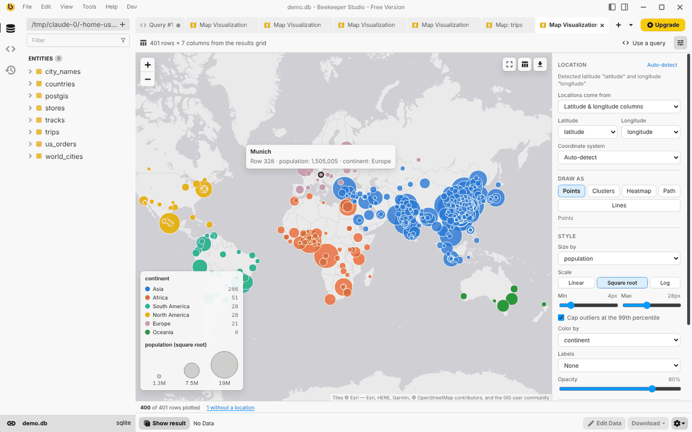
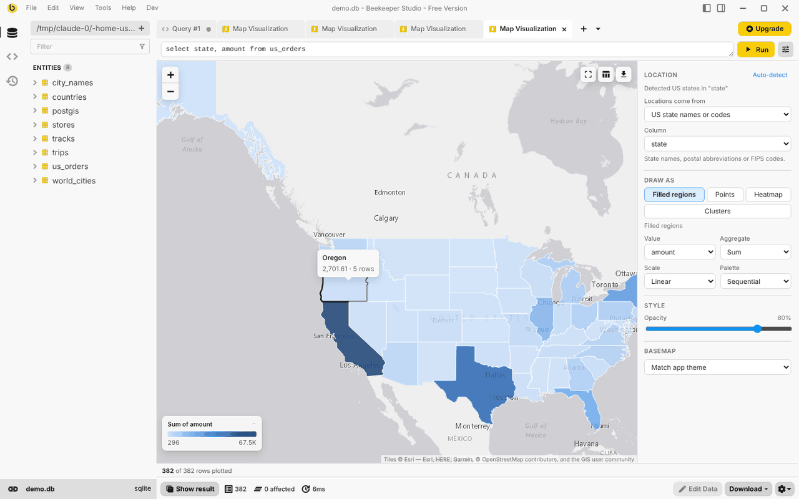
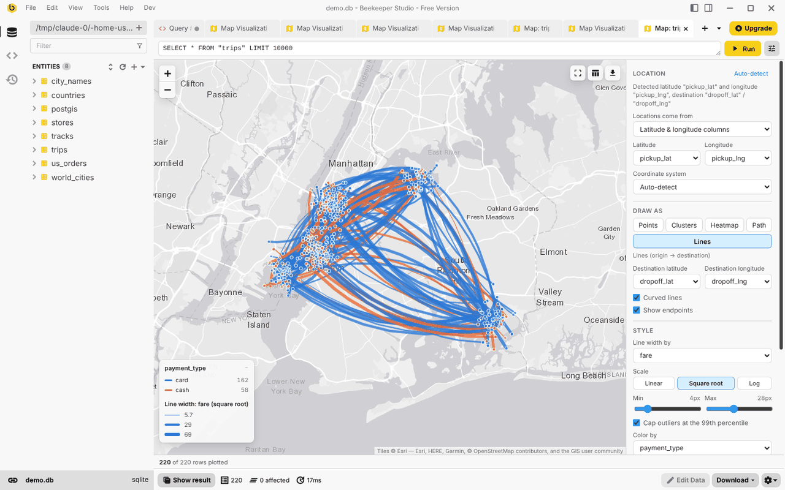

# Map Visualization for Beekeeper Studio

Plot query results on an interactive map, right inside [Beekeeper Studio](https://www.beekeeperstudio.io).
Point it at any result set with coordinates, geometry, or place names and pick how to draw it:
dots, sized bubbles, numbered markers, clusters, heatmaps, paths, flow lines or filled regions.



## Installing

Beekeeper Studio ships with community plugins switched off. Turn them on in `user.config.ini`
(`~/.config/beekeeper-studio/` on Linux, `~/Library/Application Support/beekeeper-studio/` on macOS,
`%APPDATA%\beekeeper-studio\` on Windows), then restart the app:

```ini
[pluginSystem]
disabled = false
communityDisabled = false
```

Once the plugin is listed in the [plugin registry](https://github.com/beekeeper-studio/beekeeper-studio-plugins),
install **Map Visualization** from **Tools → Manage Plugins**. Until then, build it and link it into the plugins
folder as described under [Development](#development).

## Opening a map

| Where | What happens |
| --- | --- |
| Right-click the top-left corner (or a column header) of a results grid or table view → **Plot on Map** | Maps the selected cells. No query is re-run. |
| Right-click in the query editor → **Plot Query on Map** | Runs the selected text (or the query under the cursor) and maps it. |
| Right-click a table in the sidebar → **View on Map** | Runs `SELECT * … LIMIT 10000` against the table. |
| New tab dropdown or **Tools → New Map** | Opens a map tab with its own query box (Ctrl/Cmd+Enter runs it). |

Query results also show up in the tab's bottom result table, so the raw rows are always one click away.

## Where locations come from

Columns are detected automatically. The detection can be overridden in the **Location** panel.

| Data | Examples |
| --- | --- |
| Latitude / longitude columns | `lat`/`lng`, `latitude`/`longitude`, `pickup_lat`/`pickup_lon`, `storeLat`/`storeLng`; decimal degrees or DMS (`40°42'46"N`) |
| Web Mercator meters | `x`/`y` in EPSG:3857, converted automatically |
| Geometry columns | PostGIS EWKB hex, WKB, WKT / EWKT, GeoJSON (text or objects), MySQL / GeoPackage binary, `{lat, lng}` or `{x, y}` objects, Mongo GeoJSON points |
| Text coordinates | `"40.7128, -74.0060"`, `(40.7, -74.0)`, `S33.92 E18.42` |
| Geohashes | `dr5regw3p` |
| Countries | names, aliases (`UK`, `South Korea`, `Côte d'Ivoire`), ISO alpha-2/3 or numeric codes |
| US states | names, postal codes, FIPS codes |
| Cities | `Paris`, `Paris, TX`, `London, Ontario`, optionally narrowed by country / state columns; ~34k cities, offline |
| US ZIP codes | `02134`, `02134-1234`, or numbers with the leading zero lost |

Fuzzy inputs are handled conservatively: swapped lat/lng columns are flipped (with a warning), ambiguous city names resolve to the most populous match,
ZIP codes without an exact centroid (PO boxes) fall back to their 3-digit ZIP area, and anything that can't be placed is counted.
Click "*N* without a location" in the status bar to see those rows in the table.
Projected geometries in other SRIDs are reported with a hint to `ST_Transform(geom, 4326)`.

## Ways to draw it

| Layer | Use it for | Options |
| --- | --- | --- |
| **Points** | Dots, bubbles, numbered markers | Size by a column (linear, square root (area-true), or log), cap outliers at the 99th percentile, color by category or number (linear, log or quantile classes; sequential or diverging), labels (row number or a column), opacity |
| **Clusters** | Thousands of overlapping points | Counts per cluster, zoom in to split |
| **Heatmap** | Density, optionally weighted by a column | Radius, blur, weight scale. Intensity is normalized per zoom so hot spots stay visible at any scale |
| **Path** | GPS tracks, routes, ordered visits | One path per group column, ordered by any column (times, sequence numbers) or row order; start / end markers |
| **Lines** | Origin → destination flows (trips, shipments) | Destination columns, curved or straight, width and color by column |
| **Filled regions** | Choropleths of countries or US states | Count rows or sum / average / min / max a column; linear, log or quantile color scale |

Hover a mark for a summary and click it for the full row, with **Show in table** and **Copy as JSON**.
Legend categories can be clicked to hide them, or Alt-clicked to show only that category.
The table button in the map toolbar sends every row in the current view to the result table below.





## Basemaps and export

- **Match app theme** (default) switches between Esri's light and dark gray canvases, built for overlaying data.
- Esri streets, topographic and satellite imagery, OpenStreetMap, OpenTopoMap, or any custom `{z}/{x}/{y}` tile URL.
- **Offline**: bundled country outlines that need no network access.
- Export as **PNG** (map and legend), **copy the image** to the clipboard, or save the plotted rows as **GeoJSON**.

Settings, the query and the viewport are saved with the tab. A restored tab only re-runs its query automatically if
it ran before and is a single read-only `SELECT`.

## Known issues

Two Beekeeper Studio bugs affect this plugin in 6.1.5 and earlier; fixes are pending upstream:

- In the Community edition, plugin tabs with a result panel (like this one) render only about 150px tall.
- **Plot Query on Map** in the query editor's context menu does nothing (the host doesn't pass the query text).

The other entry points work in the meantime.

## Development

Requirements: Beekeeper Studio 5.5+, Node.js 20.19+, Yarn 1.

```bash
yarn install
yarn dev        # links the plugin into Beekeeper Studio's plugins folder and hot-reloads
yarn test       # unit tests (vitest)
yarn build      # type-check + production build into dist/
```

`yarn dev` symlinks this folder into the plugins directory (`~/.config/beekeeper-studio/plugins/bk-plugin-map-visualization`
on Linux). The link name must match the `id` in `manifest.json`.

```
src/
  App.vue                 data sources, state, popups, export
  components/             settings panel, legend, icons
  lib/geo/                WKB / WKT / geohash / DMS parsing, regions, offline geocoding
  lib/detect.ts           column auto-detection
  lib/build.ts            rows -> plottable items (CRS, axis order, geocoding)
  lib/model.ts            sizes, colors, aggregates, legends
  lib/renderer.ts         Leaflet layers
  data/                   generated lookup tables (see below)
```

The lookup tables in `src/data/` are generated from public datasets:

```bash
# download cities15000.zip, countryInfo.txt and admin1CodesASCII.txt from https://download.geonames.org/export/dump/
# and 2023_Gaz_zcta_national.zip from the US Census gazetteer, unzip them into one folder, then:
yarn geodata /path/to/that/folder
```

### Releasing

Bump `version` in `manifest.json`, then push a matching tag (`git tag v1.0.0 && git push origin v1.0.0`).
The release workflow tests, builds and creates a draft GitHub release with `manifest.json` and the plugin zip.

## Data sources and licenses

- City data © [GeoNames](https://www.geonames.org), [CC BY 4.0](https://creativecommons.org/licenses/by/4.0/).
- Country and state shapes from [Natural Earth](https://www.naturalearthdata.com) via `world-atlas`, and US Census via `us-atlas` (public domain).
- ZIP code centroids from the US Census Bureau ZCTA gazetteer (public domain).
- Map tiles are provided by their respective services (Esri, OpenStreetMap, OpenTopoMap) under their own terms; attribution is shown on the map.
- Built with [Leaflet](https://leafletjs.com), Leaflet.markercluster and Leaflet.heat.

This plugin is licensed under the GPL-3.0. See [LICENSE](LICENSE).
